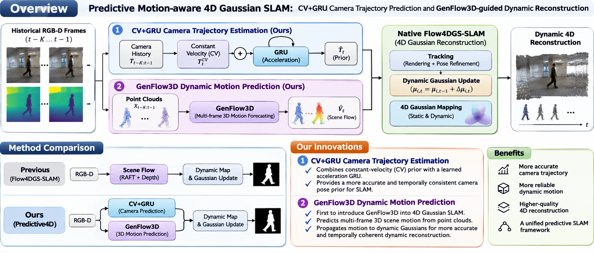

# Predictive Motion-aware 4D Gaussian SLAM

**Native Flow4DGS-SLAM integration with CV+GRU camera-motion prediction and GenFlow3D scene-flow forecasting**

> **Research prototype — not yet a fully validated, general-purpose 4D SLAM system.** This repository includes a completed native Bonn experiment and reproducibility scripts, alongside additional reference research modules that are not all enabled in the native experiment.

## 1. Overview



*Figure 1. Predictive Motion-aware 4D Gaussian SLAM overview. The CV+GRU branch forecasts a camera pose prior, while GenFlow3D predicts point-level scene flow that is transferred to native dynamic Gaussian centers via guarded correspondence. The original Flow4DGS tracker, mapper, and RAFT fallback are retained.*


The project extends [Flow4DGS-SLAM](https://github.com/wangys16/Flow4DGS-SLAM) with two predictive components:

1. **CV+GRU camera trajectory prior.** A constant-velocity (CV) SE(3) extrapolation is corrected by a trained GRU predicting gated 6-DoF acceleration. The GRU uses **six completed historical camera poses**, their relative motion and real timestamps; it does not use target-frame ground truth.
2. **GenFlow3D-guided dynamic Gaussian motion.** The official [GenFlow3D](https://github.com/ustc-hlli/GenFlow3D) network forecasts point-level 3D Scene Flow from previous world-space RGB-D point clouds. An adapter matches the forecast to **existing native dynamic Gaussians** and proposes updates to their keyframe center offsets (`_delta_xyz`). If matching or safety checks fail, the original Flow4DGS optical-flow propagation remains the fallback.

Native Flow4DGS retains its Gaussian rasterizer, keyframe mapping, temporal representations and rendering evaluation. **GenFlow3D is not trained to directly output Gaussian centers in this implementation**: predicted Scene Flow is transferred to Gaussian centers via a correspondence adapter.

### Current native pipeline

```text
Historical RGB-D frames + completed estimated camera poses
                       |
        +--------------+----------------+
        |                               |
  Camera history (6)             RGB-D point clouds (3)
        |                               |
  SE(3) Constant Velocity        Official GenFlow3D
        + GRU acceleration         (BDCB/STIB architecture)
        |                               |
   Predicted T_cw(t)               Predicted 3D Scene Flow
        |                               |
        v                               v
  Native camera prior           Point-to-Gaussian matching
        |                               |
  Flow4DGS static tracking      Accepted dynamic center offsets
        |                               |
        +---------------+---------------+
                        |
        Native Flow4DGS keyframes + 4D Gaussian mapping
                        |
             Rendering, trajectory and metrics
```

**Dynamic masks in the completed experiment:** the initial static/dynamic regions originate from the **native Flow4DGS YOLO segmentation and RAFT/depth rigid-motion residual**, not from a standalone GenFlow3D segmentation head or the separate Pre-Ours pipeline. Native `motion_mask` uses `True` for pixels permitted for static tracking; it is inverted where a dynamic mask is required. An optional Pre-Ours fusion and the planned probabilistic GenFlow3D motion-consistency mask are **future work**, not validated modules in this experiment.

## Camera and Dynamic Motion Formulation

### CV+GRU Camera Trajectory Estimation

Using historical estimated camera poses (world-to-camera, `T_cw`) and measured frame timestamps, the constant-velocity camera prior is

$$
T_t^{\mathrm{CV}} =
\operatorname{Exp}\!\left(
\frac{\Delta t_t}{\Delta t_{t-1}}
\operatorname{Log}\!\left(T_{t-1}T_{t-2}^{-1}\right)
\right)T_{t-1}.
$$

Here, `Exp` and `Log` are the SE(3) exponential and logarithm maps. A GRU estimates an effective 6-DoF acceleration correction from six *completed* historical poses:

$$
\widehat{\mathbf a}_t = f_{\mathrm{GRU}}(\mathcal H_{t-1}).
$$

The gated acceleration corrects the constant-velocity prediction:

$$
\widehat T_t =
\operatorname{Exp}\!\left(
\frac{1}{2}\Delta t_t^2\,G(\widehat{\mathbf a}_t)
\right)T_t^{\mathrm{CV}}.
$$

The gate `G` independently suppresses acceleration components that do not meet the configured linear and angular thresholds. This is a **camera-pose prior**, subsequently refined by native SLAM tracking.

**Implementation:** `src/predictive4d/cv_acceleration.py`, `src/predictive4d/native_pose_compat.py`, `src/predictive4d/paper_native.py`.

### GenFlow3D-guided Dynamic Motion Prediction

The official GenFlow3D model uses multi-frame point clouds to forecast *point-level scene flow* (not directly Gaussian parameters). For a 3D point from the latest observed frame,

$$
\widehat{\mathbf X}_{i,t} =
\mathbf X_{i,t-1} + \widehat{\mathbf V}_{i,t},
$$

where `V` is the predicted three-dimensional displacement over the target interval. A point-to-Gaussian correspondence adapter maps valid displacements onto **existing** native dynamic Gaussian centers:

$$
\boldsymbol{\mu}_{i,t} =
\boldsymbol{\mu}_{i,t-1} + \Delta\boldsymbol{\mu}_{i,t}.
$$

Only correspondences passing dynamic probability, distance, motion magnitude, and temporal consistency checks are applied. Otherwise, the native Flow4DGS optical-flow-based propagation is used as fallback.

**Implementation:** `src/predictive4d/paper_native.py`, `src/predictive4d/flow4dgs_native.py`, `src/predictive4d/official_bridge.py`.

## 2. Implementation status

| Component | Main files | Status |
| --- | --- | --- |
| CV + gated acceleration GRU | `src/predictive4d/cv_acceleration.py` | Implemented; loads trained `CVAccelerationGRU-v1` checkpoint |
| Causal native inference | `src/predictive4d/paper_native.py` | Implemented; uses historical frames only |
| Official GenFlow3D inference | `src/predictive4d/paper_native.py`, official external GenFlow3D checkout | Integrated; successful inference does not guarantee native Gaussian update |
| Predicted Scene Flow → Gaussian center offsets | `src/predictive4d/flow4dgs_native.py`, `official_bridge.py` | Implemented with association, motion and keyframe-gap gates; native fallback retained |
| Native Flow4DGS frontend/backend hooks | `scripts/patch_flow4dgs.py` | Guarded/idempotent source patcher for specific upstream source layout |
| CUDA and Python compatibility | `scripts/patch_native_compat.py`, `scripts/prepare_genflow3d_imports.py` | Patches observed Colab compatibility issues |
| SE(3) numeric compatibility | `src/predictive4d/native_pose_compat.py` | Small SO(3) drift can be projected; corrupted poses rejected |
| Probabilistic three-hypothesis motion decomposition | `probabilistic.py`, `joint_ba.py` | Research/reference modules; full native mask-fusion claim not established |
| Reliability Fusion Head | `fusion_head.py`, `train_fusion.py` | Optional reference experiment; not part of the reported native comparison |
| Compact reference pipeline | `pipeline.py`, `network.py`, `torch_renderer.py` | For development and smoke tests; **not** the native CVPR SLAM backend |

## 3. Repository structure

```text
configs/
  joint.yaml                         # Compact reference pipeline
  genflow_joint.yaml                 # Research configuration
  flow4dgs_native_extra.yaml         # Example merge snippet, NOT complete Bonn YAML
scripts/
  setup_native_environment.py        # Coordinated source patches and CUDA checks
  patch_flow4dgs.py                 # Native camera/cache/backend hooks
  patch_native_compat.py            # CUDA/plotting compatibility fixes
  prepare_genflow3d_imports.py      # Isolate upstream GenFlow3D imports
  build_bonn_native_config.py       # Complete native Bonn config + actual timestamps
  audit_native_run.py               # Count actual Gaussian updates and fallbacks
src/predictive4d/
  cv_acceleration.py                 # CVAccelerationGRU-v1 and causal SE(3) features
  paper_native.py                    # Native CV+GRU + GenFlow3D predictor
  native_pose_compat.py              # Guarded SE(3) correction
  flow4dgs_native.py                # Native predicted camera/flow packet application
  flow4dgs_online.py                # Alternative online prediction interface
  official_bridge.py                # Packet schema and Gaussian matching
  ...                               # Research and reference modules
results/                              # Not tracked; external outputs in Google Drive
tests/                                # Unit and patch-reproducibility tests
```

## 4. Local development (VS Code / Windows)

```powershell
cd "D:\ESPACE\Foundation model\code\Predictive4D-Framework"
python -m pip install -e ".[test]"
python -m pytest -q
```

Windows is suitable for editing and testing Python logic. The **native** Flow4DGS rasterizer, PointNet2 and PyTorch3D GPU integration requires a compatible Linux/CUDA environment (for example, Google Colab). Do not run the compact `predictive4d run` command as a substitute for native SLAM evaluation.

## 5. Native Colab/Linux setup

The following reproduces the **code preparation workflow**. It is not a claim that every fresh Colab GPU environment will compile without dependencies, compatible toolchains or pretrained checkpoints.

```bash
cd /content
git clone https://github.com/ZexuZang/Predictive-Motion-aware-4D-Gaussian-SLAM.git
git clone --recursive https://github.com/wangys16/Flow4DGS-SLAM.git
git clone https://github.com/ustc-hlli/GenFlow3D.git
```

Use the Python interpreter that contains native Torch/CUDA extensions (the original experiment used `/content/flow4dgs_env/bin/python`, Python 3.10):

```bash
cd /content/Predictive-Motion-aware-4D-Gaussian-SLAM
PY=/content/flow4dgs_env/bin/python

# First inspect planned changes (does not modify upstream sources).
$PY scripts/setup_native_environment.py \
  --upstream /content/Flow4DGS-SLAM \
  --genflow /content/GenFlow3D \
  --python "$PY"

# Apply only to a separate modified Flow4DGS checkout, never the pure baseline.
$PY scripts/setup_native_environment.py \
  --upstream /content/Flow4DGS-SLAM \
  --genflow /content/GenFlow3D \
  --python "$PY" --apply

$PY -m pip install --no-deps -e .
$PY -m pytest -q tests/test_cv_acceleration.py \
  tests/test_native_pose_compat.py tests/test_native_patch_repro.py
```

If native CUDA extensions are not installed, `setup_native_environment.py` also supports `--build-cuda`. PyTorch3D may require `--pytorch3d-source <official-source-directory>`. Download and verify weights separately; the repository does not include checkpoint files.

### Required external checkpoints

- Official `GenFlow3D` checkpoint, e.g. `/content/GenFlow3D/pretrain/GenFlow3d_nuscenes.pth`
- Trained `CVAccelerationGRU-v1` checkpoint, e.g. `/content/drive/MyDrive/Fast4D_SLAM/CameraHead_Pilot/cv_gated_acceleration_v1/cv_acceleration_gru_best.pt`
- Original Flow4DGS RAFT and YOLOv9 segmentation weights

The GRU checkpoint must contain the expected architecture and training metadata; random initialization is not acceptable for evaluation.

## 6. Bonn native CV+GRU + GenFlow3D experiment

Prepare the Bonn stride-3 RGB-D dataset in Google Drive. The config builder checks `rgb.txt`, `depth.txt`, `groundtruth.txt`, reads the official parser's frame ordering, and writes real processed-frame timestamps. It also provides `--mode cv` for a separate CV-only ablation.

```bash
PY=/content/flow4dgs_env/bin/python
ROOT=/content/Predictive-Motion-aware-4D-Gaussian-SLAM

$PY "$ROOT/scripts/build_bonn_native_config.py" \
  --python "$PY" \
  --upstream /content/Flow4DGS-SLAM \
  --genflow /content/GenFlow3D \
  --genflow-checkpoint /content/GenFlow3D/pretrain/GenFlow3d_nuscenes.pth \
  --cv-gru-checkpoint /content/drive/MyDrive/Fast4D_SLAM/CameraHead_Pilot/cv_gated_acceleration_v1/cv_acceleration_gru_best.pt \
  --joint-config "$ROOT/configs/genflow_joint.yaml" \
  --data /content/drive/MyDrive/Datasets/Bonn/rgbd_bonn_person_tracking_stride3 \
  --output /content/drive/MyDrive/Fast4D_SLAM/Native_Paper_SLAM_CVGRU \
  --packet-dir /content/native_flow_packets_cv_gru \
  --mode cv_gru \
  --config-out /content/Flow4DGS-SLAM/configs/rgbd/bonn/bonn_native_cv_gru_genflow.yaml

cd /content/Flow4DGS-SLAM
$PY -u slam.py \
  --config configs/rgbd/bonn/bonn_native_cv_gru_genflow.yaml \
  --eval --yolo 1 --save_results 1 --iters 50 \
  --exp_name CVGRU_GenFlow3D_repro
```

**Important:** the original Flow4DGS baseline must run in a *separate, unmodified official checkout* with matching dataset, evaluation, renderer and mapping settings. The modified checkout initializes the first pose without GT; ensure a fair common initialization/evaluation convention before interpreting differences.

### Audit what GenFlow3D actually changed

```bash
PY=/content/flow4dgs_env/bin/python
ROOT=/content/Predictive-Motion-aware-4D-Gaussian-SLAM

$PY "$ROOT/scripts/audit_native_run.py" \
  --log /path/to/your/native_run.log \
  --packet-dir /content/native_flow_packets_cv_gru \
  --result-dir /path/to/your/native_result_directory \
  --save-json /path/to/native_run_audit.json
```

This audit separates **network inference records** from **GenFlow3D Gaussian-offset applications** (`PREDICTIVE4D_GENFLOW_APPLIED`) and **RAFT fallback events** (`PREDICTIVE4D_NATIVE_FLOW_FALLBACK`). The paths above must be replaced by actual output paths.

## 7. First experiment: Bonn Person Tracking (stride 3)

The following numbers come from the previously completed **194-frame** experiment and common-frame offline evaluation; they have **not** been freshly reproduced from a clean checkout of this README.

| Metric | Original Flow4DGS-SLAM | CV+GRU+GenFlow3D | Direction |
| --- | ---: | ---: | :---: |
| ATE RMSE, common-frame SE(3) alignment (m) | 0.189424 | **0.091552** | ↓ |
| RPE translation RMSE, Δ=1 sampled frame (m) | 0.053590 | **0.043623** | ↓ |
| RPE rotation RMSE, Δ=1 sampled frame (degrees) | 3.738101 | **3.626036** | ↓ |
| PSNR, before refinement (dB) | 19.860777 | **21.241728** | ↑ |
| SSIM, before refinement | 0.754707 | **0.811516** | ↑ |
| LPIPS, before refinement | 0.421586 | **0.318278** | ↓ |
| PSNR, after refinement (dB) | 24.228287 | **26.398473** | ↑ |
| SSIM, after refinement | 0.810705 | **0.855004** | ↑ |
| LPIPS, after refinement | 0.321322 | **0.237600** | ↓ |

The common-frame aligned ATE decreased by approximately **51.7%** in this experiment. The native `plot/ATE_0.json` reports different values because of a different evaluation convention; do not mix these definitions. The RPE Δ=1 is measured between consecutive **stride-3 sampled** frames.

### Scientific limitations

- The Bonn stride-3 sequence was also involved in GRU development/training; this is **not an independent held-out evaluation**.
- Historical audit of the completed run found **2 GenFlow3D Gaussian-offset application events and 38 RAFT fallback events**. Therefore the improvements **cannot yet be attributed solely to GenFlow3D**.
- The dynamic mask in this run comes from **native RAFT/YOLO**, not the proposed independent GenFlow3D-guided probabilistic motion segmentation or optional Pre-Ours fusion.
- Predicted flow variance in current packet generation is a **proxy**, not a calibrated uncertainty estimate.
- The reference Schur/probabilistic modules and camera-fusion experiments are not evidence that the complete proposed joint probabilistic SLAM operates in the native experiment.
- Report the upstream commit IDs, initialization conventions, flow update acceptance statistics and hardware/software environment for reproducibility.

## 8. Next experiments

1. Run independent **CV-only**, **CV+GRU**, **native Flow4DGS** and **GenFlow enabled/disabled** ablations with matched settings.
2. Diagnose low GenFlow3D offset acceptance (point-to-Gaussian correspondence, scene-flow units, dynamic prior, keyframe gap and motion thresholds).
3. Evaluate on held-out sequences with true per-frame timing and trained model checkpoints not fitted to the evaluation sequence.
4. Develop and evaluate a **GenFlow3D motion-consistency dynamic mask** independently of the optional Pre-Ours mask; measure IoU, precision/recall and temporal consistency before claiming mask fusion improvements.
5. Evaluate ATE/RPE, EPE3D, PSNR/SSIM/LPIPS, dynamic reconstruction consistency and runtime/FPS with repeatable configuration snapshots.

## 9. Documentation and references

- [Native Colab reproducibility guide](docs/NATIVE_CVGRU_COLAB_REPRODUCIBILITY.md)
- [Architecture and implementation-status contract](docs/FINAL_NOTION_ALIGNMENT.md)
- [Experimental camera fusion](docs/FUSION_HEAD_IMPLEMENTATION_CN.md)
- [Flow4DGS-SLAM official implementation](https://github.com/wangys16/Flow4DGS-SLAM)
- [GenFlow3D official implementation](https://github.com/ustc-hlli/GenFlow3D)

**Repository:** [ZexuZang/Predictive-Motion-aware-4D-Gaussian-SLAM](https://github.com/ZexuZang/Predictive-Motion-aware-4D-Gaussian-SLAM)
